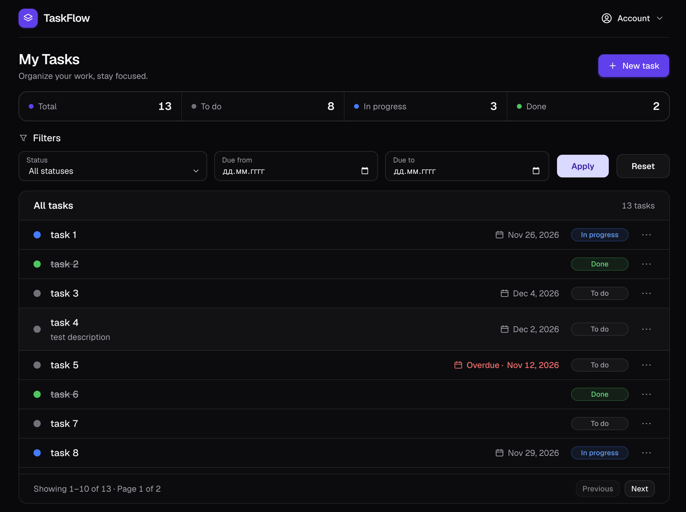
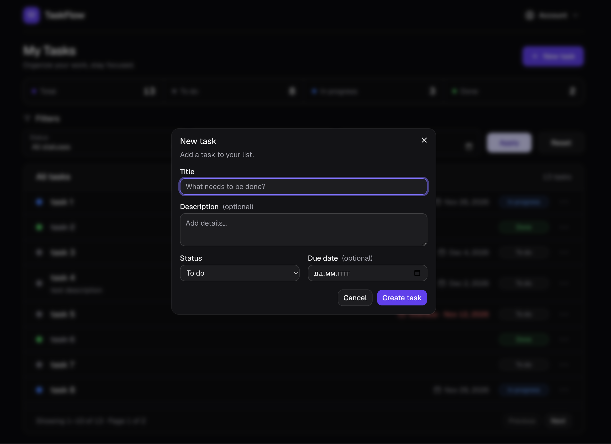
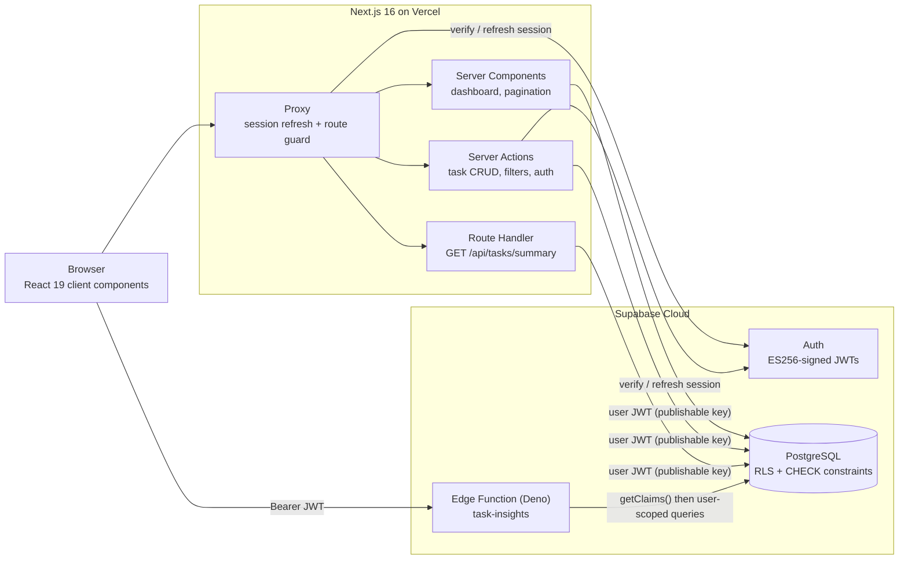

# TaskFlow

**A secure, multi-user task manager built with Next.js 16 and Supabase.**

### [▶ Live demo: taskflow-roan-chi.vercel.app](https://taskflow-roan-chi.vercel.app)

Sign up with your email, confirm it, and you get a private task list. Your data is isolated from every other user by PostgreSQL Row Level Security, not only by application code.

---

## Why this project

TaskFlow is intentionally small in scope and deep in engineering. It shows how to build a production-minded SaaS feature set end to end:

- **Real authentication**: email/password with email confirmation, server-verified sessions and no trust in client-supplied identity.
- **Defense in depth**: route protection in the Next.js Proxy, per-request verification in every page and Server Action, and RLS plus CHECK constraints in the database.
- **Correct data at scale**: server-side pagination with stable ordering and exact counts that stay accurate past Supabase's 1,000-row response limit.
- **Modern React/Next.js**: App Router, Server Components with Suspense streaming, Partial Prerendering, Server Actions with `useActionState`, and forms that work without JavaScript.
- **Tested behavior**: integration suites run against a local Supabase stack and cover RLS, cross-user attacks, pagination edge cases, the HTTP API and the Edge Function.

## Screenshots

**Dashboard**: statistics bar, saved filters, task list with status badges and overdue indicator, and server-side pagination.



**Create task**: dialog with title, optional description, status and optional due date.



## Features

### Authentication
- Email/password sign-up and sign-in with Zod validation. Emails are normalized and passwords must be 8–72 characters.
- Email confirmation through `/auth/confirm`, supporting both the PKCE `code` and `token_hash` links.
- Sessions are kept in cookies via `@supabase/ssr` and refreshed by the Next.js Proxy on each request.
- `/dashboard` is protected. `/` sends signed-in users to the dashboard and everyone else to sign-in. Signed-in users visiting `/login` or `/signup` are sent to the dashboard.
- Every redirect goes to a fixed path; no redirect target is taken from user input.

### Task management
- Create and edit tasks in a dialog with a title, optional description, status (*To do*, *In progress*, *Done*) and optional due date.
- Change status or delete (with confirmation) from each row's actions menu.
- Overdue indicator for open tasks past their due date.
- Validation messages appear inline, and failures show generic, non-leaking errors.

### Filtering and pagination
- Filter by status and by an inclusive due-date range.
- Filters are **saved per user** in the database and restored on the next visit. Apply and Reset return to page 1.
- **Server-side pagination**, 10 tasks per page, ordered by `created_at DESC, id DESC` so pages never overlap or skip rows.
- The page lives in the URL (`/dashboard?page=2`). Invalid values redirect to page 1 and out-of-range values to the last page.

### Analytics
- **Statistics bar** with Total, To do, In progress and Done. It reads `GET /api/tasks/summary`, ignores filters and pagination, and reloads only after a task changes.
- **`task-insights` Edge Function** (`POST /functions/v1/task-insights`) returns `{ overdue, eligible, overduePercentage }` for the caller. It is deployed and tested as a standalone API and is not yet shown in the UI.

### Security
- RLS on every table with owner-only policies for SELECT, INSERT, UPDATE and DELETE. Ownership cannot be spoofed or transferred.
- Database CHECK constraints mirror the Zod rules, so direct Data API writes are bounded too.
- Only the public (publishable) Supabase key is used. No service-role or secret key exists anywhere in the app.
- Security headers on every response: `frame-ancestors 'none'` / `X-Frame-Options: DENY`, `nosniff` and a strict `Referrer-Policy`. `X-Powered-By` is removed.
- User-specific API responses send `Cache-Control: no-store`.

### UX and accessibility
- Responsive layout. On desktop the dashboard fits the viewport and only the task list scrolls.
- Light and dark themes follow the system preference, and `prefers-reduced-motion` is respected.
- Labelled regions, dialogs that return focus to their trigger, and keyboard-accessible menus.

## Tech stack

| Layer | Technology |
| --- | --- |
| Framework | Next.js 16 (App Router, Turbopack, Cache Components / Partial Prerendering) |
| UI | React 19, TypeScript, Tailwind CSS 4, shadcn/ui on Base UI |
| Validation | Zod 4 |
| Backend | Supabase: PostgreSQL, Auth, Data API (PostgREST), Edge Functions (Deno) |
| Supabase clients | `@supabase/ssr` and `@supabase/supabase-js` |
| Testing | Node.js built-in test runner against a local Supabase stack |
| Hosting | Vercel (app) and Supabase Cloud (database, auth, functions) |

## Architecture



### Responsibilities

| Part | Responsibility |
| --- | --- |
| **Next.js Proxy** (`src/proxy.ts`) | Refreshes the Supabase session cookie on every request and redirects as a first pass: signed-out users away from `/dashboard`, signed-in users away from the auth pages. It is **not** the authorization boundary. |
| **Server Components and Actions** | Each one verifies the user with `getClaims()` (signature-checked JWT) via `requireUser()` or `getUser()` (`src/lib/auth.ts`). They validate all input with Zod and run queries with the user's own token. `user_id` always comes from the verified token, never from the request. |
| **Route Handler** (`/api/tasks/summary`) | JSON API for the statistics bar. Returns 401 JSON when signed out, generic 500s on failure and `no-store` caching. Counts come from three count-only queries, so no rows are transferred. |
| **PostgreSQL and RLS** | The final authority on access. Owner-only policies on `tasks` and `user_preferences`, explicit grants with no `anon` access, and CHECK constraints for status, text length and date ranges. |
| **Edge Function** (`supabase/functions/task-insights`) | Deno function with `verify_jwt = false` at the gateway, because the project uses asymmetric ES256 signing keys. It verifies the caller's token itself with `getClaims()` before any query and queries through a client carrying that token, so RLS still applies. |

### Notable implementation details
- **`getClaims()` instead of `getSession()`**: identity is always taken from a signature-verified JWT, never from cookie contents alone.
- **Count-only queries** (`count: "exact", head: true`): totals and analytics stay exact past the 1,000-row API limit without downloading rows.
- **Partial Prerendering**: the dashboard shell is static, and all user-specific content streams in behind Suspense. Identity checks call `connection()` so they never run during prerendering.
- **Progressive enhancement**: sign-in and the filter form are Server Action forms that work without JavaScript, which the integration tests rely on.

## Project structure

```
src/
  proxy.ts                 Session refresh + route guard (Next.js 16 Proxy)
  lib/auth.ts              getUser() / requireUser(): verified identity
  lib/supabase/            Server and browser Supabase clients, generated DB types
  app/auth/                Auth Server Actions, auth form, /auth/confirm handler
  app/login, app/signup    Auth pages
  app/dashboard/           Dashboard page, Server Actions, task UI, filters, stats
  app/api/tasks/summary/   Statistics Route Handler
  components/ui/           shadcn/ui primitives (Base UI)
supabase/
  migrations/              Schema, grants + RLS policies, text-length constraints
  functions/task-insights/ Deno Edge Function
  config.toml              Local stack + function configuration
tests/                     Integration suites (see tests/README.md)
scripts/insights-smoke.mjs Authenticated smoke test for the deployed function
```

## Getting started

### Prerequisites
- Node.js 22+ with Corepack (the pnpm version is pinned in `package.json`)
- Docker, for the local Supabase stack. The Supabase CLI runs through `pnpm dlx`, so no global install is needed.

### Setup

```sh
git clone https://github.com/AndriiKasian/taskflow.git
cd taskflow
corepack pnpm install
cp .env.example .env.local
```

Set these in `.env.local`. Both are **public** values; the app never needs a secret key.

| Variable | Description |
| --- | --- |
| `NEXT_PUBLIC_SUPABASE_URL` | Supabase project URL |
| `NEXT_PUBLIC_SUPABASE_PUBLISHABLE_KEY` | Supabase publishable key (`sb_publishable_…`) |

**Option A: local Supabase.** Migrations are applied automatically on start. Copy the API URL and publishable key it prints into `.env.local`.

```sh
corepack pnpm dlx supabase@3.2.0 start
```

**Option B: your own Supabase project.** Link the project and apply the migrations, then use its URL and publishable key.

```sh
corepack pnpm dlx supabase@3.2.0 link --project-ref <project-ref>
corepack pnpm dlx supabase@3.2.0 db push --remote
```

Then start the app:

```sh
corepack pnpm dev        # http://localhost:3000
```

To run the Edge Function locally: `corepack pnpm dlx supabase@3.2.0 functions serve`.

## Scripts

| Script | Purpose |
| --- | --- |
| `pnpm dev` | Start the development server |
| `pnpm build` / `pnpm start` | Production build and server |
| `pnpm lint` | ESLint (Next.js core-web-vitals + TypeScript rules) |
| `pnpm typecheck` | Generate route types, then `tsc --noEmit` |
| `pnpm test:database` | RLS policies and table constraints through the Data API |
| `pnpm test:api` | `GET /api/tasks/summary`: auth, isolation, caching, failures, >1,000 rows |
| `pnpm test:dashboard` | Root redirect, pagination, filters and cross-user Server Action attempts |
| `pnpm test:functions` | `task-insights` Edge Function: auth, counting, rounding, CORS, methods |

Prefix with `corepack` (e.g. `corepack pnpm dev`) to use the pinned pnpm version.

## Testing

The integration suites use **Node's built-in test runner** and the existing Supabase client, with no extra test framework. They exercise the real system: real sign-in, real Server Actions, real PostgREST requests and real JWTs.

- **Local only.** Every suite refuses to run when `SUPABASE_URL` is not `localhost`/`127.0.0.1`.
- **Disposable users.** Each run signs up users with random credentials and deletes them afterwards. Their tasks and preferences cascade.
- **Attacker's perspective.** Tests try to read, modify, reassign or delete another user's data via the Data API and by calling Server Actions directly. Same-user control checks prove the rejections come from authorization, not from malformed requests.
- **Edge cases.** Covered cases include more than 1,000 tasks, identical timestamps, invalid and out-of-range page numbers, forged, tampered and expired tokens, and simulated database failures with no leaked details.

See [`tests/README.md`](tests/README.md) for the exact commands and environment variables (`SUPABASE_URL`, `SUPABASE_PUBLISHABLE_KEY`, `BASE_URL`).

### Production smoke test

`scripts/insights-smoke.mjs` checks the **deployed** `task-insights` function as a real user. It prompts for credentials (the password is not echoed), calls the function and prints only the HTTP status, `Cache-Control` and the JSON body. It never prints tokens and always signs its own session out.

```sh
node --env-file=.env.local scripts/insights-smoke.mjs
```

## Deployment

- **Vercel:** import the GitHub repository, set `NEXT_PUBLIC_SUPABASE_URL` and `NEXT_PUBLIC_SUPABASE_PUBLISHABLE_KEY`, and deploy. Both values are public and inlined at build time.
- **Supabase:**
  - Apply the migrations with `supabase db push --remote`.
  - Deploy the function with `supabase functions deploy task-insights`; `config.toml` sets `verify_jwt = false`.
  - In Auth settings, set the Site URL and the `/auth/confirm` redirect URL to the production domain, keep email confirmation on, and set the minimum password length to 8.
  - Configure custom SMTP so confirmation emails reach any user, not only project members.

## License

No license file is included yet; all rights reserved by the author.
